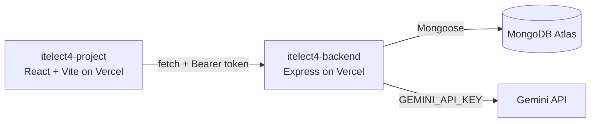

- Backend: https://itelect4-backend-eight.vercel.app
- Frontend: https://itelect4-project-it-4-b-ten.vercel.app
- Frontend Repo: https://github.com/goraphael703-lang/itelect4-project-IT4B.git

# itelect4-backend
 

 
The REST API behind the ITELECT4 class demo, end of Session 12: Express 5
in TypeScript, MongoDB Atlas through Mongoose, JWT login, and one route
that asks Gemini to review a project description.
 
- **Live API:** https://itelect4-backend-xxxx.vercel.app/api/health
- **Frontend repo:** https://github.com/meloimagpantay/itelect4-project
 
## Architecture
 
